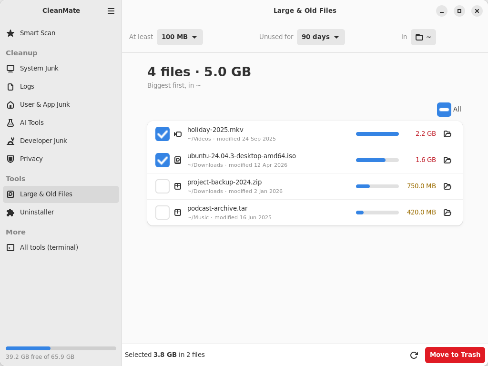
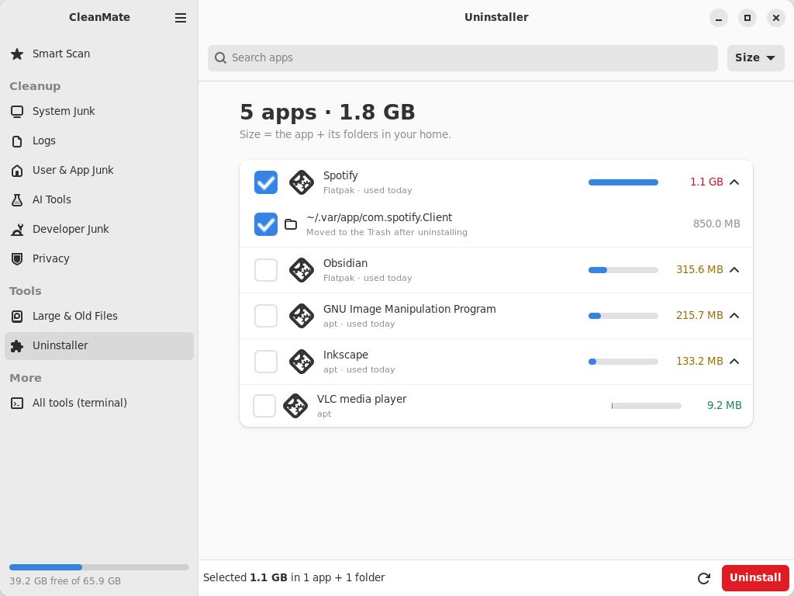
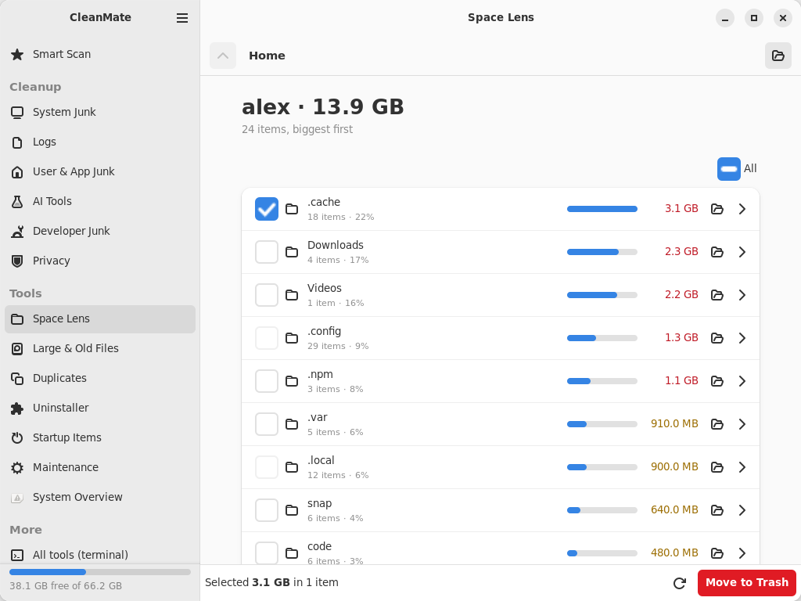
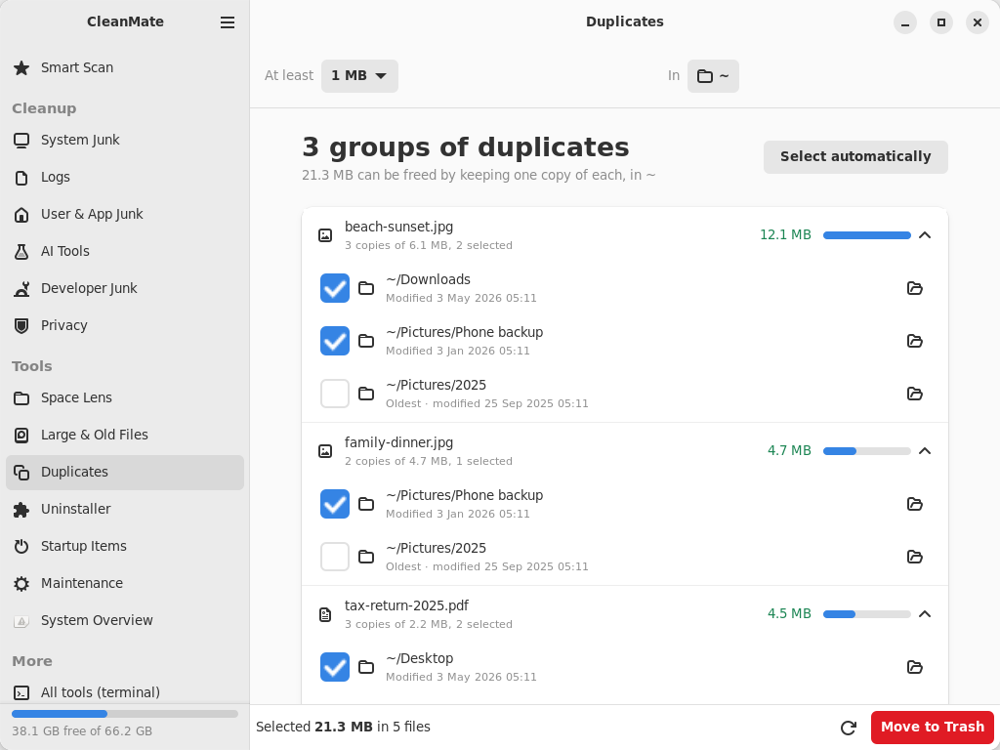
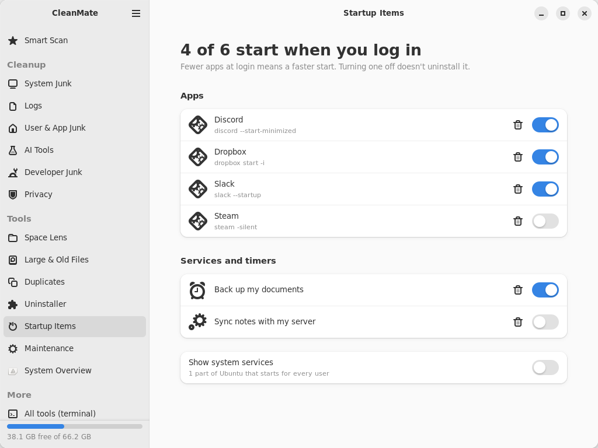
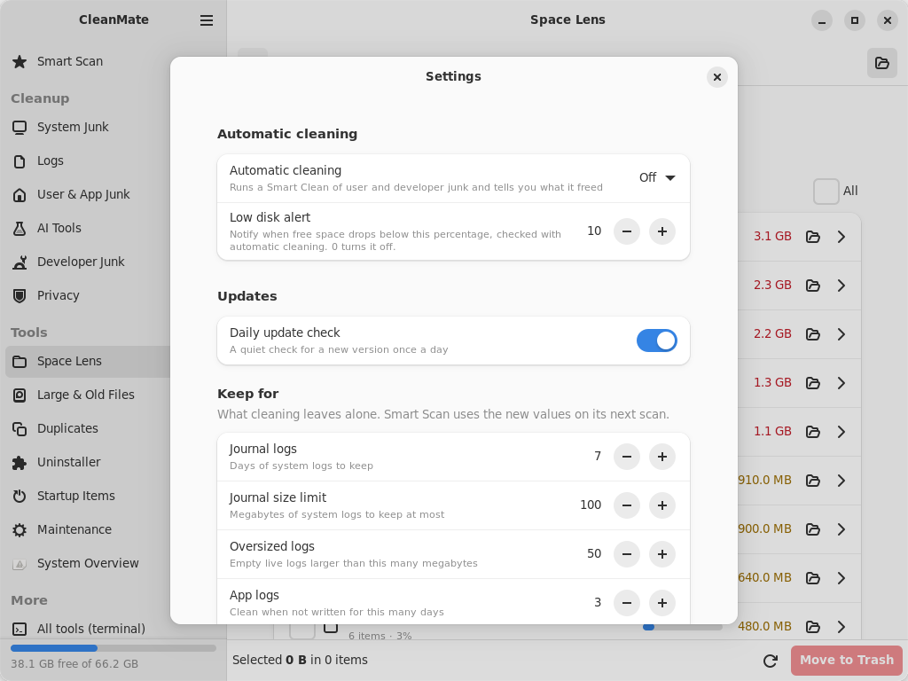

<p align="center">
  
</p>

<h1 align="center">CleanMate</h1>

<p align="center">
  <a href="https://github.com/homielab/cleanmate-linux/actions/workflows/ci.yml"></a>
  
  <a href="https://launchpad.net/~homielab/+archive/ubuntu/cleanmate"></a>
  
  
  <a href="https://ko-fi.com/homielab"></a>
</p>

**Free up disk space and keep Ubuntu tidy — safely.** CleanMate finds caches, old logs,
leftovers of removed apps, developer and AI-tool clutter, and shows you exactly what it would
remove. Nothing is deleted until you confirm. It's a desktop app *and* a terminal app (`cm`)
that share one engine.

[Install](#install) · [What it cleans](#what-it-cleans) · [Safety](#safe-by-design) · [FAQ](#faq) · [Report a bug](https://github.com/homielab/cleanmate-linux/issues)


## Why

I moved from macOS to Ubuntu and missed [CleanMyMac](https://macpaw.com/cleanmymac): one place
that tells you what's eating your disk and lets you clean it safely. Ubuntu has all the pieces —
`apt-get clean`, `journalctl --vacuum`, `snap remove --revision`, `docker image prune` — but you
have to know they exist and remember the flags. CleanMate puts them behind one Scan button,
with a terminal version first, because that's where most Linux users live.

## Install

**Ubuntu 24.04 LTS** — from the [PPA](https://launchpad.net/~homielab/+archive/ubuntu/cleanmate),
with updates through Software Updater:

```bash
sudo add-apt-repository ppa:homielab/cleanmate
sudo apt install cleanmate
```

Then open **CleanMate** from *Show Apps*, or run `cm` in a terminal.

**Any Ubuntu, without `sudo`** (including 22.04):

```bash
curl -fsSLO https://raw.githubusercontent.com/homielab/cleanmate-linux/main/cleanmate.sh
bash cleanmate.sh --install
```

That adds the app to *Show Apps* and the `cm` command to your terminal, all inside your home
folder. On Ubuntu 22.04 the app grid opens the terminal app (the desktop app needs 24.04+).

**Other ways**

- **Package:** download `cleanmate_<version>_all.deb` from
  [Releases](https://github.com/homielab/cleanmate-linux/releases), double-click it (App Center)
  or `sudo apt install ./cleanmate_*_all.deb`.
- **Just try it:** `bash cleanmate.sh --dry-run` — everything works, nothing is deleted.

Also available for macOS: [CleanMate for macOS](https://github.com/homielab/cleanmate-macos).

## Use it

**Desktop app** — open *CleanMate*, press **Scan**, untick anything you want to keep, press
**Clean**. Click anywhere on a row to tick it; the **All** box on a group ticks or clears the whole
group. **Keyboard:** Ctrl+1…9 open System Overview, Smart Scan, the six cleanup pages and Space Lens, Ctrl+R (or F5) scans, searches or lists again on the open page, and Ctrl+? lists every shortcut. After a clean, the result shows *Free space: before → after*; if the clean moved anything to the Trash (old installers and downloads, stale build folders, editor data of deleted projects), **Undo** in the message puts it back for 10 seconds — everything else is deleted for good, and the confirmation says which. Items with a 🔒 need your password (the standard Ubuntu dialog); everything else runs
as you. An item whose program is running is locked until you close it. **Space Lens** lists what
takes up the space in your home folder (or any folder or drive), biggest first: click a folder to
dig deeper, tick what you don't need and move it to the Trash, **Undo** puts it back. On a writable
drive mounted under `/media`, `/run/media` or `/mnt` things go to that drive's own Trash, so the space
comes back on that drive; read-only and network drives, Timeshift backups and other places outside your
home folder it only shows. **Duplicates** groups identical files (from 1 MB, in a folder or drive you
pick); nothing is ticked until you choose, and **Select automatically** ticks every copy except the oldest
(usually the original); you're warned if every copy of a file is ticked.
**Large & Old Files** lists
your biggest files (by minimum size, how long unused, and folder or drive); what you move to the
Trash comes back with **Undo**, also from a USB or other drive (it goes to that drive's own Trash). **Startup Items** switches the apps and your systemd user services
that start at login on or off (a service or timer also starts or stops right away; the system's own services are only shown); removing one of yours
moves its file to the Trash, with **Undo**. **Uninstaller** removes apt, Snap, Flatpak and AppImage apps — tick several (say,
everything unused for 12+ months) to remove them with one confirmation and one password; an app that is running
is skipped — and, if you tick them, the folders they leave in your home (to the Trash, with **Restore folders**); folders of apps you removed earlier are a group of their own
at the end, not ticked, with **Undo** after moving them to the Trash. **Reset…** keeps one app installed and moves
its data in your home to the Trash, so it starts as if new (pick which folders; **Restore** puts them back). **Maintenance** runs the terminal app's maintenance
tasks (updates, package repair, TRIM, font cache, locate…) with their output in a log window, asking for your
password once per task, and switches the snap-versions and journal-size limits on or off; a task whose tool
isn't installed is locked. The app opens on **System Overview**: your system and package counts, each disk
with a usage bar (in the warning colour over 90 % full), a chart of free space over the last 30 days, memory
and swap, what CleanMate freed (the last 30 days, in total and the last cleanup, with a bar per day over the
last 30 days), space in use outside your folders (Timeshift snapshots, the swap file, ext4's reserved space),
your largest folders, which open in Space Lens, and **System
protection**: whether the firewall (ufw), AppArmor, automatic security updates and Secure Boot are on. It
only reads them; one that is off shows the command that turns it on, with a button to copy it. One it
can't read shows *Unknown*.

| Large & Old Files | Uninstaller |
| --- | --- |
|  |  |
| Space Lens | Duplicates |
|  |  |
| Startup Items | Settings |
|  |  |

**Terminal app** — run `cm`. Press `1` for a Smart Scan, `c` to clean.


| Key | Action |
|---|---|
| `↑` `↓` / `j` `k` / mouse wheel | Move |
| `space` | Select or deselect (on a group header: the whole group) |
| `enter` / `→` | Open, or show exactly what's inside an item |
| `c` | Clean what's selected — you see the list and confirm first |
| `a` / `n` | Select all / none |
| `h` | Show or hide items that are already clean |
| `/` | Find a row by name |
| `z` | Undo: put back what you just moved to the Trash |
| `q` / `esc` / `←` | Back |
| `?` | Help |

Your choices are remembered by both apps: untick something once and it stays unticked.

## What it cleans

**Smart Scan** checks all of these at once (≈ 1 s):

| | What | Examples |
|---|---|---|
| **System Junk** | Package and system leftovers | APT cache, unused packages, extra old kernels (a fallback always stays), leftover configs, old Snap revisions, old temp files; old installers in Downloads (`.deb`, AppImage, `.iso`… over 30 days old by default — change it in Settings › Old installers; only a Downloads folder inside your home folder, not pre-selected, moved to the Trash; each file on its own in the desktop app); old downloads — files and folders at the top of Downloads you haven't opened or changed for 90 days (a folder counts as used when anything inside it was; change it in Settings › Old downloads; not pre-selected, moved to the Trash; each one on its own in the desktop app); old screenshots — screenshots and screen recordings (`Screenshot from …`, `Screencast from …`, `Screenshot_<date>…`) at the top of Pictures or Pictures/Screenshots untouched for as long (same setting; not pre-selected, moved to the Trash; each file on its own in the desktop app); abandoned downloads — unfinished `.crdownload`, `.part`, `.aria2` and `.!qB` files at the top of Downloads untouched for 7 days, together with the file of the real name Firefox and aria2 keep next to them (not pre-selected, moved to the Trash; each download on its own in the desktop app) |
| **Logs** | Logs nobody reads | systemd journal (keeps 7 days), rotated logs, oversized live logs (e.g. a 300 MB `syslog`), crash reports, core dumps, old app logs |
| **User & App Junk** | Your caches | Trash, the Trash on USB and other drives (not pre-selected; each drive on its own in the desktop app), thumbnails, stale caches, and **each browser** and **each app** (VS Code, Slack, Discord, Steam's shader cache, Dropbox, Nextcloud, ownCloud and MEGAsync caches, the Telegram Desktop media cache and the Spotify cache (not pre-selected; Spotify's cache also holds songs downloaded for offline listening), Snap and Flatpak apps) as its own choice |
| **AI Tools** | AI assistant clutter | caches, logs and *old* sessions of Claude Code, Claude Desktop, Codex, Gemini/Antigravity, Cursor, Windsurf, opencode, Cline, Kilo Code, MiMoCode, ZCode, Zed, Copilot CLI, Continue; data of deleted projects in VS Code, Cursor, Windsurf and VSCodium (`workspaceStorage`, also the Snap and Flatpak builds; not pre-selected, moved to the Trash, skipped while the editor runs; each project on its own in the desktop app) |
| **AI Models** | Downloaded models | **each** Ollama, Hugging Face and LM Studio model on its own — never pre-selected, never cleaned automatically; interrupted Ollama downloads (`sha256-…-partial`, also in `OLLAMA_MODELS`) are one more item, skipped while Ollama runs (LM Studio: `~/.lmstudio/models`, `~/.cache/lm-studio/models` and the folder set in its My Models); models PyTorch Hub, Whisper, sentence-transformers and Keras downloaded (`~/.cache/torch`, `~/.cache/whisper`, `~/.keras`, also `TORCH_HOME`, `SENTENCE_TRANSFORMERS_HOME`, `KERAS_HOME`, `XDG_CACHE_HOME`) are one more item, each model on its own in the desktop app; a model a program has open is skipped |
| **Developer Junk** | Build and package caches | npm, Yarn, pnpm, Bun, pip, uv, Go, Cargo, rustup downloads, Gradle, Maven, Conda, Deno, Zig, Bazel, ccache, sccache, NuGet, Poetry, pre-commit, pipx run; Docker images, build cache, containers and volumes (each separately; in the desktop app also one by one: dangling images, build-cache records, unused images and unused volumes — a named volume is marked *may hold data*; with Docker 23 or newer, cleaning the whole volumes item removes only anonymous volumes, so its size counts only those); stale `node_modules` and build folders count only what deleting frees (files pnpm or Bun hard-linked from their store are left out); Podman; Playwright, Puppeteer and Cypress browsers (never pre-selected); Firebase CLI logs and downloaded emulators (not pre-selected); the Dart and Flutter pub cache (hosted packages and git cache, not pre-selected, skipped while dart or flutter runs); old runtime versions — every version nvm (Node.js), SDKMAN, fvm (Flutter), pyenv (Python), rbenv (Ruby) or rustup (Rust toolchains) installed, and every Go SDK in `~/sdk`, that isn't your default (nvm's `alias/default` and other aliases, the `node` on your PATH, SDKMAN's `current`, fvm's `default`, what pyenv's and rbenv's `version` file names, rustup's default toolchain and overrides, the Go SDK your `go` runs from are kept, as is a pyenv version holding virtualenvs; a tool without a default keeps every version; not pre-selected, deleted, a version a program runs from is skipped; each version on its own in the desktop app); `node_modules` of projects idle for 90 days; build folders of projects idle for 90 days — Cargo `target/`, Python `.venv/`, CocoaPods `Pods/` (not pre-selected, moved to the Trash; each project on its own in the desktop app); Android emulator system images no virtual device uses (`~/Android/Sdk`, `ANDROID_HOME`, `ANDROID_SDK_ROOT`; not pre-selected, deleted, skipped while Android Studio, the emulator or sdkmanager runs; each image on its own in the desktop app); Android emulator snapshots — the `snapshots` folder of each virtual device (AVD), often GBs each; the next start is a cold boot, the device's apps and data stay (not pre-selected, deleted, skipped while the emulator runs; each AVD on its own in the desktop app); old JetBrains IDE and Android Studio versions — the settings, plugins, caches and logs an upgrade leaves behind (`IntelliJIdea2023.1`, `AndroidStudio2023.3`… in `~/.config`, `~/.local/share` and `~/.cache`, also Flatpak and Snap builds) when a newer version of the same IDE is there; never the newest, not pre-selected, moved to the Trash, skipped while that IDE runs; each version on its own in the desktop app; old extension versions of VS Code, VS Code Insiders, VSCodium, Cursor and Windsurf (`~/.vscode/extensions` and the like, also the Flatpak builds) — the folders an extension update leaves behind, and versions the editor marked obsolete; the newest version and any version the editor's `extensions.json` names are kept (not pre-selected, deleted, skipped while that editor runs; each extension on its own in the desktop app) |

**Privacy** (never part of Smart Scan) clears shell history (bash, zsh, fish), *Recent files*,
Python/Node/database shell history, Vim history, and the Alt+F2 and emoji history. Each browser
(Firefox, Chrome, Chromium, Brave, Edge, Vivaldi, Opera; deb, Snap and Flatpak, every profile) is
its own item: browsing history, the downloads list and cookies, which signs you out of websites.
Passwords, bookmarks, extensions, saved cards and settings are kept. Not pre-selected, skipped while
the browser runs; Firefox needs `sqlite3` (it clears the records, so bookmarks in the same file stay).

**More tools in the terminal app** (Space Lens, Large & Old Files, Duplicates, the Uninstaller, Startup Items, Maintenance, System Overview and Settings are in the desktop app too):

- **Uninstaller** — every app you can open (apt, Snap, Flatpak, and AppImage apps with a launcher in
  `~/.local/share/applications`), with its real size (the app *plus* its folders in your home) and when
  you last used it. An AppImage app goes to the Trash as you — the file, its launcher and the icon only
  it uses — so you can put it back. Sort by size or last use, or show only apps
  you haven't opened in 90+ days (desktop app: unused for 1, 3, 6 or 12+ months). Parts of Ubuntu itself are hidden, and a removal that would take
  something Ubuntu needs with it (GNOME Shell, the login screen, sudo, the running kernel…) is
  refused. Afterwards it offers the app's own folders for the Trash — never folders other apps share.
  The last row, **Leftovers of removed apps**, lists folders no installed app uses any more:
  `~/.var/app/<id>` of a Flatpak app and `~/snap/<name>` of a snap that are gone, and folders in
  `~/.config`, `~/.local/share`, `~/.local/state` and `~/.cache` whose name matches no package, snap,
  Flatpak app, launcher, command (also from the PATH your shell profile sets) or running program.
  Folders the desktop or many apps share (dconf, GTK, fonts, keyrings…), folders with programs in
  them, changed in the last 30 days or with a file open are never listed. Nothing is ticked; they go
  to the Trash (`z` puts them back).
  `r` resets the selected app: it stays installed, its folders in your home (for a Flatpak app its
  cache, config and data; for a snap its current revision and `common`) go to the Trash, so it
  starts as if new — `z` puts them back. Refused while the app runs.
- **Maintenance** — update everything (with a list of what will change first), repair packages,
  TRIM, free RAM, and lasting limits so old snap versions and system logs don't pile up again.
- **System Overview** — storage, free-space history, space outside your folders (Timeshift
  snapshots, the swap file, ext4's reserved space), your largest folders, and whether the firewall,
  AppArmor, automatic security updates and Secure Boot are on (read only, with the command to fix one).
- Space Lens (browse folders by size), Large & Old Files (here with virtual machine disks),
  Duplicates, Startup Items (login apps) and Settings.

## Safe by design

- **You see everything first.** Every clean lists the items and sizes and asks; `→` shows the
  exact files. `--dry-run` shows the commands without running them.
- **It uses the system's own tools** — `apt-get clean`, `journalctl --vacuum-*`,
  `snap remove --revision`, `docker image prune`, `npm cache clean` — instead of deleting by hand.
- **Your files go to the Trash**, in the standard format, and `z` puts them back.
- **It never touches** logins and keys (`.ssh`, `.gnupg`, `auth.json`, `.credentials.json`, …),
  settings, bookmarks, Claude Code memory, the running kernel or its fallback.
- **Recent things stay:** only logs, sessions and caches older than a limit you control are
  removed; apps that are running are asked about (and skipped when unattended).
- **System paths are hard-blocked** (`/`, `/usr`, `/etc`, your home folder itself, …), and when it
  runs as root it refuses anything inside a home folder.
- **Folders you never want touched:** add them in *Settings → Never clean* (both apps). Large & Old
  Files, Duplicates, Space Lens, stale `node_modules` and project build folders, old installers and old
  downloads skip them, and nothing in them is moved to the Trash. Only folders inside your home folder, not
  the home folder itself. Smart Scan's caches and logs ignore the list: their apps rebuild them.
- **Everything is logged** to `~/.local/state/cleanmate/clean.log` (*Settings → Activity log* in both apps).

## Automatic cleaning

*Settings → Automatic cleaning* runs a weekly (or daily, monthly) clean of user and developer
junk and notifies you: *"Freed 1.2 GB. Worth a look: Docker build cache 2.0 GB, Google Chrome
1.8 GB."* It never empties the Trash, never touches browsers, apps or Cargo, Python and CocoaPods
build folders and never needs your password. In the desktop app it's in *Settings* in the main
menu (Ctrl+,); both apps share the same settings.

## Low disk alert and scan reminder

CleanMate notifies you when `/` has less than 10 % free (*Settings → Low disk alert*: 5–20 % or
Off; once a day at most) and, if you turn on *Settings → Scan reminder*, when you haven't scanned
for a week or a month. A daily systemd user timer (`cleanmate-check.timer`) checks while either is
on, and the desktop app checks the disk when it opens. Click the notification to open CleanMate.
Check now with `cm --check`.

## Command line

```bash
cm --scan                        # what would Smart Scan find? (changes nothing)
cm --clean                       # Smart Scan, confirm once, clean
cm --clean --yes --only logs     # clean logs without asking
cm --scan --only privacy         # what history is stored?
cm --check                       # low disk alert and scan reminder now
cm --help                        # all options
```

## Update & uninstall

**Installed from the PPA or the `.deb`:** Software Updater (or `sudo apt upgrade`) keeps it up to
date; remove it with `sudo apt remove cleanmate`.

**Installed with the script:**

```bash
cm --update       # shows your version and the latest, asks, updates the app and icon
cm --uninstall    # removes cm, the desktop app and the Show Apps entry; asks about settings
```

The app also checks for a new version once a day (one request to GitHub; nothing about you is
sent) and shows **⬆ Update** in the menu — turn it off in *Settings → Daily update check*.

## FAQ

**Is it safe to clean the APT cache, journal and old snaps?**
Yes — that's what `apt-get clean`, `journalctl --vacuum-time` and `snap remove --revision` are for.
Packages are downloaded again if ever needed; the snap version you run is never removed.

**After cleaning, Ubuntu offered an upgrade to a new Ubuntu version. Did something break?**
No. Removing old Snap revisions makes systemd reload, which can bring Ubuntu's routine *"new
release available"* check forward. You can turn that prompt off in *Software & Updates → Updates*.

**Why is my `syslog` so big?**
Usually one service logs far too much. *Logs → Oversized active logs* empties it safely;
`sudo tail -n 1000 /var/log/syslog` shows who's flooding it.

**How does the Uninstaller know when I last used an app?**
From GNOME Shell's own record of opened apps (`~/.local/share/gnome-shell/application_state`),
or else the newest change in the app's own folders (config, cache, data) in your home. Apps with
neither show *Unknown*: they are not counted as unused, so the *Unused for 1/3/6/12+ months*
filter hides them until you press *Show* under the list.

**Does it work over SSH?** Yes — use the terminal app; colours and the mouse work in any modern terminal.

**Where does it keep its data?** `~/.config/cleanmate` (choices, settings, Never clean folders) and
`~/.local/state/cleanmate` (activity log, last scan, stats), plus the sizes of your project folders and the list of unused
packages in `~/.cache/cleanmate` for faster scans. Nothing is sent anywhere —
see the [privacy policy](docs/PRIVACY.md).

## Contributing

Bug reports and pull requests are welcome — [CONTRIBUTING.md](CONTRIBUTING.md) explains how it
works, how to add a cleaner and how to run the tests. Plans are in
[docs/ROADMAP.md](docs/ROADMAP.md), releases in [CHANGELOG.md](CHANGELOG.md).
The desktop app is in English and Vietnamese, cleanup item names and descriptions included. It
follows the system's language; *Settings → Language* picks English or Tiếng Việt for CleanMate alone
(restart the app to apply). To translate it, see *Translations* in CONTRIBUTING.md (`po/`).

## Support

CleanMate is free and always will be. If it saved you some space (or some time), you can
[buy me a coffee on Ko-fi](https://ko-fi.com/homielab) ☕ — it keeps the project going.

## License

[MIT](LICENSE) © 2026 [HomieLab](https://homielab.com) · contact@homielab.com

*CleanMate is an independent open-source project, not affiliated with MacPaw or CleanMyMac.*
